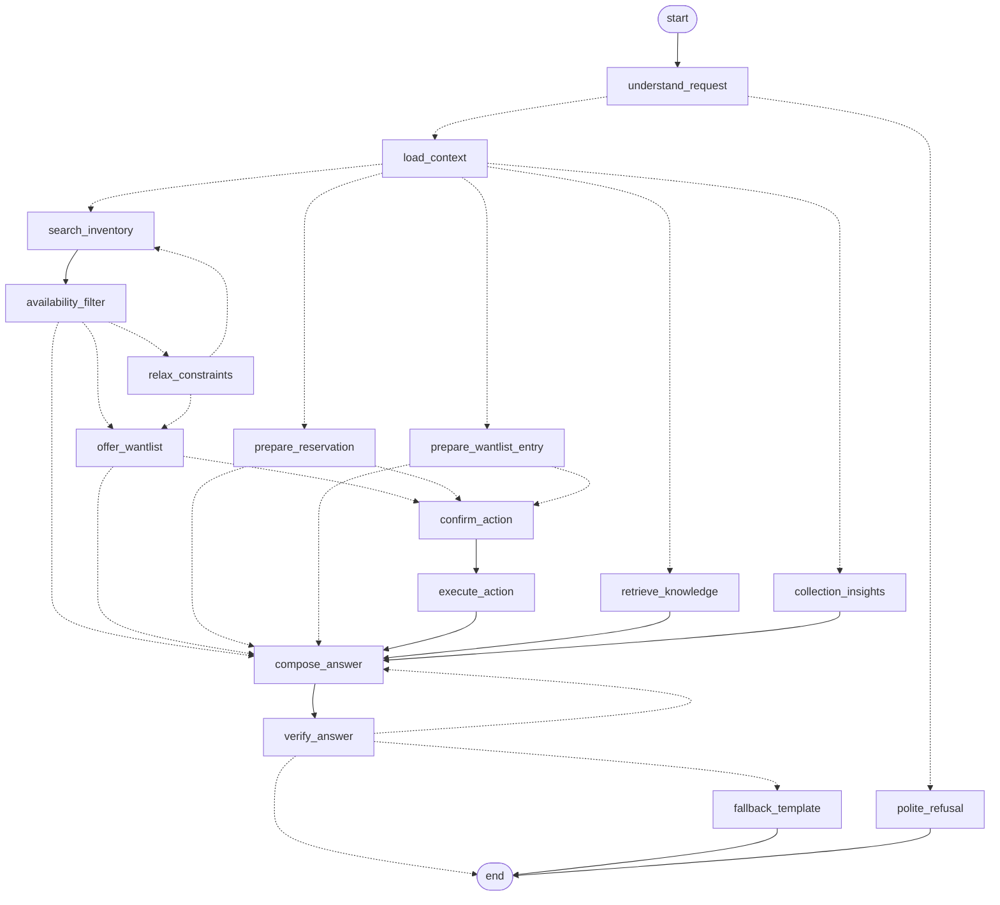

# Record Store Assistant

An AI shop assistant for a vinyl record store. Customers chat with it in plain language: it searches the store's stock, explains vinyl topics from a knowledge base, gives tips based on their own collection, and reserves records or adds them to a wantlist after they confirm. Staff manage inventory and knowledge articles, and see demand analytics.

Built with **FastAPI**, **LangGraph**, **LangChain**, **PostgreSQL + pgvector**, **Gemini** and **Streamlit**, and run with **Docker Compose**.

Final project for the *AI Engineering with Python* course at IT Academy Step, Tbilisi.

## What it can do

**Customers**
- Ask for records in their own words ("some 70s jazz-funk under $40 in VG+ or better") and get real copies that are in stock.
- If nothing matches, the assistant relaxes the search step by step. If there's still nothing, it offers to add the record to their wantlist.
- Ask vinyl questions (grading, original vs. reissue, cleaning, 180-gram vinyl…) answered from the store's own articles (RAG).
- Get suggestions based on their collection and taste profile.
- Reserve a copy or add to the wantlist from the chat. The assistant asks for confirmation before it changes anything.
- Browse the catalog and manage their collection, wantlist, reservations and profile.

**Staff**
- Manage inventory and catalog records.
- Write and edit knowledge articles. They are re-indexed into the vector store automatically.
- Analytics: what customers ask for, demand the store can't meet yet, reservation stats and chat intents.

## Architecture

```
Streamlit UI  ──HTTP / SSE──►  FastAPI  ──►  LangGraph agent  ──►  Gemini (chat + embeddings)
  :8501                         :8000              │
                                   │               ▼
                                   └──────►  PostgreSQL 17 + pgvector
                                             (app data, vectors, agent checkpoints)
```

Three Docker Compose services: `db`, `api`, `ui`. Only the UI is exposed on all interfaces. The database and API listen on `127.0.0.1` only.

### The agent graph

Every chat message runs through a LangGraph state graph with 16 nodes. Dotted arrows are conditional routes (`app/ai/routing.py`).



The full generated diagram is in [`docs/graph.md`](docs/graph.md). It's regenerated with `python -m scripts.draw_graph`.

### Design decisions

- **Hybrid search.** SQL first applies the hard rules (in stock, price, condition, format, decade, genre, artist). Vector similarity then ranks only the copies that pass. Finally, a taste score nudges the order toward the customer's profile (`app/repositories/search.py`).
- **Answers are verified before the customer sees them.** `verify_answer` checks the drafted answer against the real data. If it fails twice, a template answer is sent instead. LLM tokens are never streamed, so a made-up price can't reach the screen.
- **Human-in-the-loop.** Reservations and wantlist entries pause the graph with a LangGraph `interrupt`. The graph resumes only after the customer confirms. State is stored with `AsyncPostgresSaver`, so a paused chat survives a restart.
- **Structured outputs.** Request analysis and answer drafts are Pydantic models (`with_structured_output`), with retries.
- **Prompt-injection defences.** Customer messages are wrapped and treated as data. The prompts tell the model never to follow instructions inside them that change prices, rules or its role.
- **RAG with a relevance cut-off.** Knowledge chunks below a similarity threshold are dropped, so the assistant says "I don't know" instead of answering from an unrelated article.
- **Role-based access.** JWT auth with `customer` and `staff` roles. There is no API endpoint to become staff; staff accounts are created with a server-side script.
- **Observability.** Every chat turn is traced in LangSmith, tagged with environment, user role and session.
- **Limits.** Per-user message rate limit and a hard timeout per chat turn.

## Tech stack

| Area | Tools |
|---|---|
| API | FastAPI, Pydantic v2, pydantic-settings, Uvicorn |
| Database | PostgreSQL 17, pgvector, SQLAlchemy 2 (async, asyncpg), Alembic |
| AI | LangGraph, LangChain, Gemini (chat + `gemini-embedding-001`), langchain-postgres (PGVector), LangSmith |
| Auth | JWT (PyJWT), Argon2 password hashing (pwdlib) |
| UI | Streamlit |
| Testing | pytest, pytest-asyncio |
| Ops | Docker, Docker Compose |

## Running it

### With Docker (recommended)

You need Docker and a [Google AI Studio](https://aistudio.google.com/) API key.

```bash
git clone https://github.com/sandroabramishvili/record-store-assistant.git
cd record-store-assistant
cp .env.example .env        # then fill in GOOGLE_API_KEY and JWT_SECRET
docker compose up --build -d
docker compose exec api python -m scripts.seed
```

Open **http://localhost:8501**. The API docs (Swagger) are at **http://localhost:8000/docs**.

Generate a `JWT_SECRET` with:

```bash
python -c "import secrets; print(secrets.token_urlsafe(48))"
```

The seed script loads 60 catalog records with copies in stock, 12 knowledge articles, their vectors, and three demo users: one staff account and two customers with different tastes. Their logins are in [`scripts/data/demo_users.json`](scripts/data/demo_users.json). It's safe to run again; `--reset` starts over.

LangSmith tracing is optional: set `LANGSMITH_TRACING=false` or leave the key empty.

### Locally (for development)

Requires Python 3.14. Run only the database in Docker:

```bash
docker compose up -d db
python -m venv .venv && source .venv/bin/activate   # Windows: .venv\Scripts\activate
pip install -r requirements.lock.txt
alembic upgrade head
python -m scripts.seed
uvicorn app.main:app --reload
streamlit run ui/app.py
```

On Windows, run the API without `--reload` and add `--loop app.loop:selector_loop_factory` (psycopg needs a selector event loop).

To create a real staff account:

```bash
python -m scripts.create_staff owner@store.com "Store Owner"
```

## Tests

```bash
pytest
```

400+ tests in four groups:

- `tests/unit`: pure logic (ranking, conditions, relaxing searches, taste, routing, prompts…)
- `tests/graph`: the LangGraph graph with fake LLMs (structure, each node, full paths, hardening)
- `tests/api`: endpoints against a real PostgreSQL test database
- `tests/ui`: the Streamlit app

The tests **never call Gemini or LangSmith**: the API key is blanked for the whole run. API tests use a separate database (`record_store_test`), created automatically, and refuse to run against any database whose name doesn't end in `_test`.

## Project structure

```
app/
  ai/            LangGraph graph, nodes, routing, prompts, LLM, vectors, checkpointer, tracing
  auth/          JWT, password hashing, role and ownership checks
  models/        SQLAlchemy models
  repositories/  database queries (search, inventory, analytics…)
  routers/       FastAPI endpoints
  schemas/       Pydantic request/response models
  services/      business rules (availability, reservations, ranking, taste…)
migrations/      Alembic migrations
scripts/         seeding, staff creation, graph diagram, try-out scripts
ui/              Streamlit app (customer and staff views)
tests/           unit, graph, api and ui tests
```
